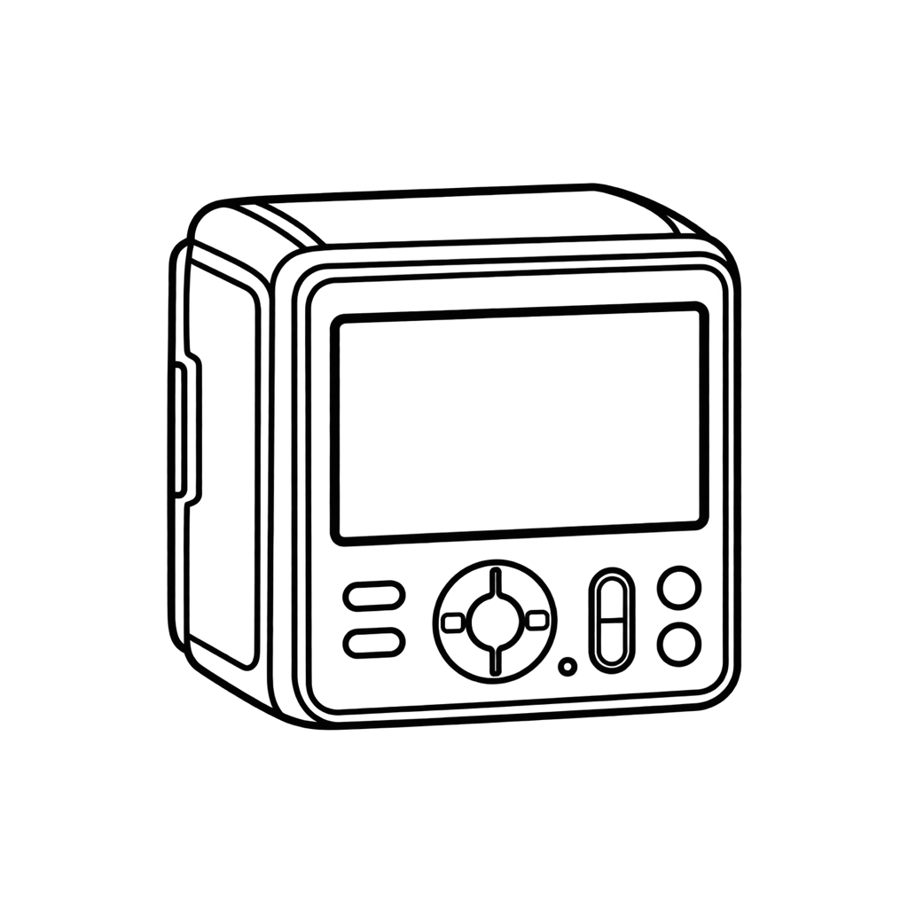

# CFV HEIC

面向初代哈苏 **CFV-50c** 的原生 macOS 工具，将 3FR 照片转换为 **10-bit HEIC**。

A native macOS app that converts original **Hasselblad CFV-50c** 3FR photos to **10-bit HEIC**.

[中文](#中文) · [English](#english) · [版本记录 / Versions](#版本记录--versions) · [开源声明 / Open source](#开源声明--open-source)

## 中文

### 功能

- **高画质转换**：保留完整解码尺寸，支持 Display P3 / sRGB，画质可调，默认 92%。
- **批量处理**：选择或拖入文件夹；也可自动监视新照片。
- **彩点修复**：自动识别黑场，按多个 ISO 建立标定策略并自动保存；转换时可选择应用。
- **36 款 LUT**：富士风格复现 34 款，以及 Kodak 克罗姆 **1930s、64 调整**；也可选择“不加 LUT”。
- **本机处理**：默认保留原始 3FR。

适用环境：**Apple Silicon Mac，macOS 12.0 及以上**。应用界面为简体中文；CFV II 50C / 907X 及其他后背尚未验证。

### 使用方法

1. 从仓库 **Releases** 下载 App 压缩包，解压后打开 **CFV HEIC.app**。更新时请先退出旧版。
2. 点击 **“选择文件夹…”**，或把包含 3FR 的文件夹拖入窗口。
3. 设置画质、P3 / sRGB 和 **“LUT 风格”**；如需彩点修复，先完成下方标定并勾选应用模板。
4. 点击 **“转换现有文件”**；也可开启 **“自动监视新文件”**，保持 App 运行以自动处理新照片。

输出保存在来源文件夹的 **`HEIC/原文件名.heic`**。普通转换只处理所选文件夹本层，已有同名 HEIC 会跳过；更换 LUT 或其他设置后，请先移走旧输出再转换。LUT 在坏点修复后应用，转换或监视期间不可切换。

**首次设置彩点修复：**

1. 使用同一台后背完全遮光拍摄黑场 3FR，每个 ISO / 曝光组建议 **10 张，至少 8 张**；同组保持相同曝光。只拍一个 ISO 也可使用。
2. 打开 **“设置标定模板…” → “选择标定文件夹”**。App 自动扫描子文件夹、识别黑场、按 ISO 建立并保存策略。
3. 回到主界面，勾选 **“转换 3FR 时应用标定模板”**。之后无需每次重新标定。

HEIC 是有损格式，不保留 RAW 的重新显影能力；如需以后重新处理，请备份原片。“核验后将原始 3FR 移入废纸篓”默认关闭，可按需开启。

## English

### Features

- **High-quality conversion:** full decoded resolution, Display P3 / sRGB, adjustable quality with a 92% default.
- **Batch processing:** choose or drag in a folder, or monitor it for new photos.
- **Hot-pixel repair:** automatically detect dark frames, build multi-ISO calibration strategies, and save them for optional use during conversion.
- **36 LUT looks:** 34 Fuji-style recreations plus Kodak Chrome **1930s** and **64 Adjusted**, with a **No LUT** option.
- **Local processing:** original 3FR files are kept by default.

For **Apple Silicon Macs running macOS 12.0 or later**. The app interface is Simplified Chinese. CFV II 50C / 907X and other backs have not been validated.

### How to use

1. Download the app archive from **Releases**, extract it, and open **CFV HEIC.app**. Quit the old version before updating.
2. Click **选择文件夹…** (Choose Folder), or drag a folder containing 3FR files into the window.
3. Choose quality, P3 / sRGB, and **LUT 风格** (LUT Look). For pixel repair, complete the calibration below and enable its checkbox.
4. Click **转换现有文件** (Convert Existing Files), or enable **自动监视新文件** (Monitor Folder) and keep the app running.

Results are saved in **`HEIC/<original-name>.heic`** inside the source folder. Conversion handles that folder only, without its subfolders. Existing same-name HEIC files are skipped; move old outputs before reconverting with another look or setting. LUTs run after pixel repair and cannot be changed during conversion or monitoring.

**Set up pixel repair once:**

1. Using the same physical back, capture completely covered dark 3FR frames: **about 10 per ISO/exposure group, at least 8**, with consistent exposure within each group. One ISO group is enough to start.
2. Open **设置标定模板…** (Calibration Setup) → **选择标定文件夹** (Choose Calibration Folder). The app searches subfolders, detects dark frames, groups them by ISO, and saves the strategy automatically.
3. Enable **转换 3FR 时应用标定模板** (Apply Calibration During Conversion). The saved strategy is reused for later conversions.

HEIC is lossy and does not retain RAW editing latitude; keep a RAW backup for future reprocessing. The option to move originals to Trash after verification is off by default.

## 版本记录 / Versions

| 版本 / Version | 日期 / Date | 更新 / Changes |
| --- | --- | --- |
| **1.9.0** | 2026-11-01 | 统一内置 36 个风格，菜单分组，匹配富士 LUT 色彩空间。 / Unified 36-look collection, grouped menu, and matched Fuji LUT encoding. |
| **1.8.0** | 2026-11-01 | 新增坏点修复后的可选 LUT 步骤，记住风格选择。 / Optional LUT stage after pixel repair, with a remembered selection. |
| **1.7.0** | 2026-10-31 | 首次公开发布：批量转换、文件夹监视和自动多 ISO 标定。 / Initial public release: batch conversion, folder monitoring, and automatic multi-ISO calibration. |

## 开源声明 / Open source

应用源码采用 **[MIT 许可证](LICENSE)**。内置 LUT 为第三方风格复现，来源和原有署名见 [第三方资源说明](docs/THIRD_PARTY_NOTICES.md)。本项目独立开发，与哈苏、富士等厂商无隶属或背书关系。

Application source code is licensed under **[MIT](LICENSE)**. Bundled LUTs are third-party style recreations; provenance and original attribution are recorded in [third-party notices](docs/THIRD_PARTY_NOTICES.md). This independent project is not affiliated with or endorsed by the camera manufacturers.

更多文档 / Further documentation: [使用细节 / Advanced usage](docs/ADVANCED_USAGE.md) · [开发与测试 / Development](docs/DEVELOPMENT.md) · [技术说明 / Technical notes](docs/TECHNICAL_NOTES.md) · [贡献 / Contributing](docs/CONTRIBUTING.md) · [完整记录 / Full history](docs/VERSION_HISTORY.md)
